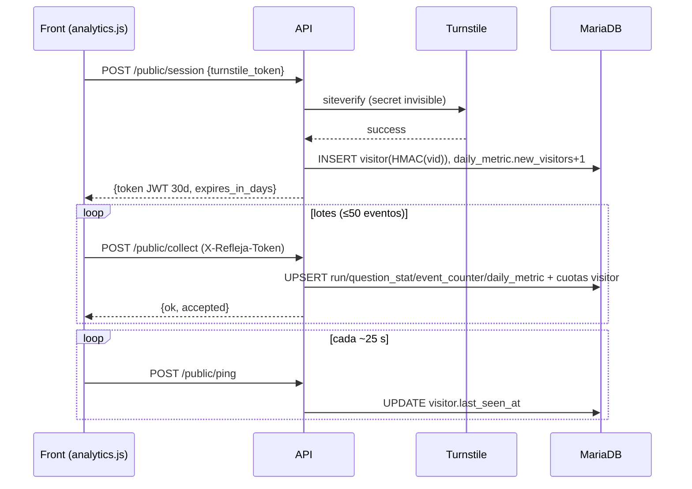

# 01 · Contexto canónico de la migración (fuente de verdad para agentes)

> Documento vivo. Distingue **hechos** (`[CONFIRMADO]`/`[EJECUTADO]`) de **propuestas** (ADR en estado `propuesta`). Si este documento contradice al código, **gana el código**: registra la discrepancia en `08` y detén el cambio afectado.
> Análisis: 2026-10-18 · commit `f4d996c` · rama `main`.

## 1. Resumen ejecutivo

**Qué es.** *Refleja* es un sitio web (estático, Cloudflare Workers, `front/`) con un cuestionario de orientación sobre violencia hacia las mujeres en Nuevo León. Su backend (`back/`, FastAPI) hace **solo tres cosas**:
1. Recibir **estadística anónima** de uso (embudo del cuestionario, municipios, clics de ayuda urgente) — sin IP ni datos personales.
2. Autenticar a administradores (Argon2id + Turnstile + JWT con refresh rotatorio).
3. Servir el **panel** `/plataforma` con agregados de esas tablas.

**Quién lo consume.** El front propio (`analytics.js`, `acceso.js`, `auth-common.js`, `platform.js`) `[CONFIRMADO]`. Otros consumidores: `[DESCONOCIDO]` (Q-04).

**Por qué se migra.** Reducir consumo de RAM (≈130 MB reportados, `[NO VERIFICADO]`, Q-01) migrando a **Rust + Axum + Tokio + Tower** con **SQLx/MariaDB**, sin cambiar contratos.

**Tamaño real del trabajo.** 15 rutas, 8 tablas, ~1 300 líneas Python, 0 pruebas, 1 integración externa (Turnstile), sin Redis/R2/colas/webhooks/WebSockets/jobs. Es una migración **pequeña en superficie pero con contratos sutiles** (ver §4).

**Dentro del alcance:** todo `back/app/**`, el comportamiento observable de las 15 rutas, el arranque/config, el empaquetado/despliegue y la suite de equivalencia.
**Fuera del alcance (explícito):** cambios en el front; cambios de esquema de datos (salvo migraciones aditivas aprobadas); nuevas funcionalidades; migración a otro motor de BD; retiro del Python antes del cutover; despliegues a producción sin autorización.

**Riesgos y decisiones pendientes principales:** esquema real de producción desconocido (Q-02/C-03); objetivo de RAM no definido (Q-12); entrega del binario según servidor (Q-11/ADR-003); fidelidad de quirks (ADR-009); acotar memoria de Argon2 (ADR-014). Detalle en `08`.

## 2. Estado actual confirmado

```mermaid
flowchart LR
  U[Navegador / sitio estático<br/>refleja.org] -->|POST session, collect, ping| CF
  A[Admin /acceso /plataforma] -->|login, refresh, platform/*| CF
  CF[Cloudflare proxy<br/>CF-IPCountry, CF-Connecting-IP] --> NG[CloudPanel / Nginx<br/>reverse proxy]
  NG -->|127.0.0.1:20832| UV[uvicorn x2 workers<br/>FastAPI]
  UV -->|PyMySQL / SQLAlchemy sync| DB[(MariaDB 11)]
  UV -->|HTTPS siteverify 8 s| TS[Cloudflare Turnstile]
  UV -.lee al arrancar.-> FJ[front/src/formulario.json]
  UV -.lee .env.-> ENV[.env]
```

Capas internas del backend (Python): `main.py` (CORS + guard de origen + health) → `routers/{public,auth,platform}.py` → `deps.py` (extractores de IP/país/token/admin) → `analytics.py` (upserts y parsers UA) / `security.py` (Argon2, JWT, HMAC) / `turnstile.py` / `form_meta.py` → `models.py` + `database.py` (SQLAlchemy síncrono; handlers `def` en threadpool).



```mermaid
sequenceDiagram
  participant P as Panel
  participant API as API
  participant DB as MariaDB
  P->>API: POST /auth/login {user, pass, turnstile}
  API->>DB: SELECT admin_user; Argon2id verify (64 MiB)
  API->>DB: INSERT admin_login, admin_session(sha256 refresh)
  API-->>P: access JWT 15 min + Set-Cookie refleja_rt (HttpOnly, Path=/api/auth)
  P->>API: GET /platform/* (Bearer)
  P->>API: POST /auth/refresh (cookie)
  API->>DB: revoke old session, INSERT new (rotación); si reuso → revoca familia
```

## 3. Inventario funcional (enlaces)
- Endpoints (EP-001…EP-016): [`02-endpoint-inventory.md`](02-endpoint-inventory.md)
- Flujos (FL-01…FL-09): [`03-business-flows.md`](03-business-flows.md)
- Datos e integraciones: [`04-data-and-integrations.md`](04-data-and-integrations.md)
- Seguridad (P-01…P-15, S-01…S-15): [`05-security-review.md`](05-security-review.md)
- Ejecución y despliegue: [`06-runtime-and-deployment.md`](06-runtime-and-deployment.md)
- Pruebas (CT-xxx): [`07-test-and-compatibility-plan.md`](07-test-and-compatibility-plan.md)
- Decisiones/Preguntas: [`08-decisions-and-open-questions.md`](08-decisions-and-open-questions.md)
- Tareas: [`09-task-plan.md`](09-task-plan.md) y `tasks/`

## 4. Contratos que deben preservarse
(Referencia exhaustiva en `02`; aquí los puntos que **no deben romperse** y que un agente suele pasar por alto.)

1. **Paths y métodos** de EP-001…EP-015, prefijo `/api`. Barra final ⇒ 307 hacia la ruta sin barra. 404/405 con `{"detail":…}`.
2. **Cuerpos JSON** idénticos en claves, tipos y valores; compactos y con UTF-8 sin escapar. Mensajes `detail` (string) **idénticos y en español** (`"Usuario o contraseña incorrectos."`, `"Falta el token estadístico."`, etc.; lista en `02`).
3. **Códigos HTTP**: 200, 307, 400 (preflight), 401, 403, 404, 405, 422, 429. En `/public/collect` y `/platform/*` el **401 precede al 422**.
4. **Autenticación**: `X-Refleja-Token` (JWT HS256, `typ=public`, `vid`), `Authorization: Bearer` (`typ=access`, `sub` string, `username`), cookie `refleja_rt` (`typ=refresh`, `jti`), con los mismos secretos ⇒ **tokens emitidos por Python deben validar en Rust y al revés** (permite cutover sin cerrar sesiones).
5. **Cookie de refresh**: `HttpOnly`, `Path=/api/auth`, `Max-Age=7d`, `SameSite=lax`(config), `Secure` en prod, `Domain` opcional; borrado con `Max-Age=0` en logout; **sin** `Set-Cookie` en los 401 de refresh.
6. **CORS**: ver `02` §0 (credenciales, métodos, cabeceras, `max-age 600`, respuestas de preflight).
7. **Efectos en BD**: mismas tablas/columnas/semántica de contadores, cuotas por token (2000/20/300) y rate limits (120/30/30 por minuto), idempotencia por qid en `form_run.counted`, `updated_at` actualizado en cada UPDATE de `form_run`.
8. **Fechas**: UTC naive; `metric_date` por fecha UTC; serialización ISO sin zona.
9. **Números**: `completion_rate`/`start_rate` redondeados a 4 decimales como `round()` de Python (ADR-012); enteros como enteros; `by_country`/`by_device` con clave `"null"` para nulos.
10. **Privacidad**: nunca persistir/loggear IP; solo país; `vid` solo como HMAC.
11. **Arranque fail-closed en producción** (secretos ≥32).
12. **Entorno**: escucha en `127.0.0.1:20832` por defecto; mismas variables de entorno (`06` §2).
13. **Compatibilidad con consumidores**: el front reintenta indefinidamente los lotes que no reciben `ok` (por eso 422/429/5xx tienen efecto operativo) y renueva token ante 401.

## 5. Arquitectura objetivo (propuesta; ver ADR en `08`)
Un único crate `back-rs/` (ADR-001) con **Axum 0.8 + Tokio + Tower/tower-http + SQLx (MySQL/MariaDB)**, `jsonwebtoken`, `argon2`, `hmac/sha2`, `reqwest (rustls)`, `tracing` (ADR-004). Un solo proceso multihilo (sustituye a 2 workers Python). Handlers `async`; Argon2 en `spawn_blocking` con semáforo (ADR-014). Rate limiter y cuotas en memoria como hoy. Sin DDL al arrancar (ADR-006).

Estructura de archivos y **propietarios** (cada archivo pertenece a **una** tarea; ver `09` §3):

```
back-rs/
  Cargo.toml  Cargo.lock  rust-toolchain.toml  rustfmt.toml  deny.toml   ← TASK-0006
  .env.example  .gitignore                                                ← TASK-0006
  migrations/                                                             ← TASK-0021
  src/
    main.rs  lib.rs                      ← 0006 (esqueleto), 0044 (cableado final)
    config.rs                            ← 0009        error.rs        ← 0010
    db.rs                                ← 0011        timefmt.rs      ← 0012
    security/{mod.rs(0006), jwt.rs(0013), hash.rs(0013), password.rs(0014)}
    turnstile.rs                         ← 0015
    app.rs (AppState + router builder)   ← 0016
    http/{mod.rs, cors.rs, origin_guard.rs}  ← 0016
    http/client.rs  (ip/país/UA)         ← 0017        http/rate_limit.rs ← 0018
    http/extract.rs (PublicVid, Admin)   ← 0020
    form_meta.rs  municipios.rs          ← 0019
    repo/{visitor.rs(0022), counters.rs(0023), form_run.rs(0024), admin.rs(0025)}
    routes/{mod.rs, health.rs}           ← 0016 (mod.rs lo crea 0006 completo)
    routes/{auth,public,platform}/mod.rs ← 0006 (agregadores completos: declaran submódulos y mezclan sus `router()`)
    routes/auth/{session.rs, cookie.rs, login.rs}(0026) refresh.rs(0027) logout.rs(0028) me.rs(0029)
    routes/public/{session.rs(0030), ping.rs(0031)}
    routes/public/collect/{mod.rs(0035), schema.rs(0032), quota.rs+actions.rs(0033), runs.rs(0034)}
    routes/platform/{filters.rs+overview.rs(0036), realtime.rs(0037), funnel.rs(0038), violence.rs(0039), municipios.rs(0040), timeseries.rs(0041), logins.rs(0042)}
    bin/refleja-admin.rs                 ← 0043
  tests/{contract/(0007,0008 + casos por tarea), vectors/, security/(0045)}
  bench/                                 ← 0046
```

No se aprueba aquí ninguna biblioteca: cada versión se verifica en TASK-0006.

## 6. Mapa de equivalencia
Estado inicial de **todas** las filas: `pendiente`.

| Origen (Python) | Destino (Rust) | Contratos clave | Pruebas que acreditan equivalencia | Tareas |
|---|---|---|---|---|
| `main.py` health/CORS/guard/docs | `app.rs`, `http/*`, `routes/health.rs` | EP-001, EP-IMP-1…4 | CT-001…009 | 0016, 0008 |
| `config.py` | `config.rs` | `06` §2, P-01, P-02 | CT-090…094 | 0009 |
| `database.py` (engine, init_db) | `db.rs`, `migrations/` | UTC, ADR-006 | integración MariaDB | 0011, 0021 |
| `models.py`, `seed.example.sql` | `repo/*`, `migrations/` | `04` §2 | L3 + volcado de tablas | 0021–0025 |
| `security.py` | `security/*`, `timefmt.rs` | P-04…P-06 | CT-053/056/068 + vectores | 0012–0014 |
| `turnstile.py` | `turnstile.rs` | P-02, P-03 | mock Turnstile | 0015 |
| `deps.py` | `http/client.rs`, `http/extract.rs` | EP-003 errores, EP-008 | CT-014/015/066 | 0017, 0020 |
| `analytics.py` (parsers, municipios) | `http/client.rs`, `municipios.rs` | normalización | vectores | 0017, 0019 |
| `analytics.py` (upserts) | `repo/*` | `04` §3 | L3 | 0022–0024 |
| `form_meta.py` | `form_meta.rs` | `04` §8 | CT-093 + vectores | 0019 |
| `routers/public.py` | `routes/public/**` | EP-002…004, FL-01…03 | CT-010…047 | 0030–0035 |
| `routers/auth.py` | `routes/auth/**` | EP-005…008, FL-04…06 | CT-050…068 | 0026–0029 |
| `routers/platform.py` | `routes/platform/**` | EP-009…015 | CT-070…081 | 0036–0042 |
| `seed.py` | `bin/refleja-admin.rs` | FL-08 | prueba manual+L3 | 0043 |
| `deploy.sh`, `deploy/*` | scripts de despliegue Rust | `06` §3 | ensayo en staging | 0047, 0048 |

## 7. Decisiones y 8. Incógnitas
Ver [`08`](08-decisions-and-open-questions.md). **Bloqueantes antes de implementar:** ADR-001, 002, 004, 006, 009, 016 aceptadas; Q-02 resuelta (TASK-0002). Las demás pueden decidirse en paralelo con la implementación de los cimientos.

## 9. Glosario rápido
`vid`: id aleatorio de visitante (solo en el JWT del cliente). `vid_h`: HMAC-SHA256 del `vid` (lo único en BD). *Run*: un intento del cuestionario (`run_uid`). *qid*: id de pregunta (`pareja_1`, `fam_3`, `age`, `start`…) más estados `MINOR/LOCATION/RESULT`. *Reached/Answered*: contadores del embudo.
