# 09 · Plan maestro de tareas

> **Estado del plan (actualizado 2026-10-18): EJECUTADO EN LOCAL.** El propietario ordenó ejecutar la migración (/goal). Código Rust completo en `back-rs/`; quedan abiertas **solo** las tareas que requieren acceso al servidor de producción (0001, 0002, 0003, 0005; imposibles de ejecutar desde este equipo) y el retiro de Python (0050, bloqueada hasta autorización explícita). _Texto original del plan:_  Hasta que el propietario apruebe el plan y las decisiones bloqueantes (TASK-0004), **ninguna tarea de código puede pasar a `lista`**. Solo las tareas de descubrimiento marcadas `lista` pueden empezar (no modifican código).
> 50 tareas · fichas en [`tasks/`](tasks/) · reglas para agentes en [`AGENT-GUIDE.md`](AGENT-GUIDE.md).

## 1. Épicas
- **EPIC-A** — Descubrimiento y decisiones (sin código)
- **EPIC-B** — Cimientos del crate y pruebas de contrato
- **EPIC-C** — Persistencia (MariaDB)
- **EPIC-D** — Dominio Auth
- **EPIC-E** — Dominio Public (estadística)
- **EPIC-F** — Dominio Platform (panel)
- **EPIC-G** — Integración, seguridad, rendimiento y operación

## 2. Registro de tareas (fuente de verdad textual)
| ID | Título | Prio | Estado | Épica | Dependencias | Ola |
|---|---|---|---|---|---|---|
| [TASK-0001](tasks/TASK-0001-medir-baseline-recursos-python.md) | Medir la línea base real de recursos del backend Python en producción | P0 | lista | A | — | ola 0 |
| [TASK-0002](tasks/TASK-0002-confirmar-esquema-real-mariadb.md) | Confirmar esquema real, versión y privilegios de MariaDB (solo lectura) | P0 | lista | A | — | ola 0 |
| [TASK-0003](tasks/TASK-0003-inventariar-configuracion-produccion.md) | Inventariar configuración efectiva y entorno del servidor de producción (sin secretos) | P0 | lista | A | — | ola 0 |
| [TASK-0004](tasks/TASK-0004-resolver-adrs-bloqueantes.md) | Revisar y resolver los ADR bloqueantes y los objetivos de éxito | P0 | completada | A | — | ola 0 |
| [TASK-0005](tasks/TASK-0005-analizar-trafico-y-consumidores.md) | Analizar tráfico real y consumidores de la API a partir de los logs del proxy | P1 | lista | A | — | ola 0 |
| [TASK-0006](tasks/TASK-0006-scaffold-crate-back-rs.md) | Crear el crate `back-rs` con el esqueleto completo de módulos y herramientas | P0 | completada | B | 0004 | ola 1 |
| [TASK-0007](tasks/TASK-0007-harness-contrato-diferencial.md) | Construir el harness de pruebas de contrato diferenciales (Python vs Rust) | P0 | completada | B | 0006, 0021 | ola 3 |
| [TASK-0008](tasks/TASK-0008-casos-contrato-meta-config.md) | Capturar casos de contrato: meta, CORS, errores de framework y arranque/config | P1 | completada | B | 0007 | ola 4 |
| [TASK-0009](tasks/TASK-0009-config-y-fail-closed.md) | Implementar `config.rs`: variables de entorno, `.env`, precedencia y fail-closed en producción | P1 | completada | B | 0006 | ola 2 |
| [TASK-0010](tasks/TASK-0010-errores-y-extractores-json.md) | Implementar `error.rs`: errores `{"detail"}`, respuestas 422 y extractores con errores propios | P1 | completada | B | 0006 | ola 2 |
| [TASK-0011](tasks/TASK-0011-pool-mariadb-y-verificacion-esquema.md) | Implementar `db.rs`: pool SQLx MariaDB, sesión UTC y verificación de esquema al arrancar | P1 | completada | C | 0009, 0021 | ola 3 |
| [TASK-0012](tasks/TASK-0012-tiempo-y-redondeo-python.md) | Implementar `timefmt.rs`: UTC naive, `isoformat` y `round(x, 4)` compatibles con Python | P1 | completada | B | 0006 | ola 2 |
| [TASK-0013](tasks/TASK-0013-jwt-y-primitivas-hash.md) | Implementar `security/jwt.rs` y `security/hash.rs`: JWT HS256 compatibles con PyJWT, SHA-256, HMAC del vid | P1 | completada | B | 0006, 0009 | ola 3 |
| [TASK-0014](tasks/TASK-0014-argon2-y-limite-concurrencia.md) | Implementar `security/password.rs`: Argon2id compatible con argon2-cffi y semáforo de memoria | P1 | completada | B | 0006, 0009 | ola 3 |
| [TASK-0015](tasks/TASK-0015-cliente-turnstile.md) | Implementar `turnstile.rs`: verificación de Cloudflare Turnstile fail-closed | P1 | completada | B | 0006, 0009 | ola 3 |
| [TASK-0016](tasks/TASK-0016-esqueleto-http-axum.md) | Implementar `app.rs`, `http/*` y `routes/health.rs`: router, CORS, guard de origen, 307/404/405 y arranque | P1 | completada | B | 0009, 0010, 0011, 0015, 0018, 0019 | ola 4 |
| [TASK-0017](tasks/TASK-0017-contexto-cliente-ua-pais-ip.md) | Implementar `http/client.rs`: IP, país y parsers de User-Agent idénticos a Python | P1 | completada | B | 0006 | ola 2 |
| [TASK-0018](tasks/TASK-0018-rate-limiter-memoria.md) | Implementar `http/rate_limit.rs`: ventana deslizante de 60 s con LRU acotado | P1 | completada | B | 0006 | ola 2 |
| [TASK-0019](tasks/TASK-0019-form-meta-y-municipios.md) | Implementar `form_meta.rs` y `municipios.rs`: allowlist de qids, flujos y slugs de municipio | P1 | completada | B | 0006, 0009 | ola 3 |
| [TASK-0020](tasks/TASK-0020-extractores-auth-publico-admin.md) | Implementar `http/extract.rs`: extractores `PublicVid` y `AdminUser` con los mismos errores | P1 | completada | B | 0013, 0016, 0025 | ola 5 |
| [TASK-0021](tasks/TASK-0021-migraciones-baseline-sql.md) | Crear migraciones SQL baseline idempotentes y la lista de esquema esperado | P0 | completada | C | 0002, 0004, 0006 | ola 2 |
| [TASK-0022](tasks/TASK-0022-repo-visitor.md) | Implementar `repo/visitor.rs`: get-or-create, touch y cuotas atómicas | P1 | completada | C | 0011, 0012, 0021 | ola 4 |
| [TASK-0023](tasks/TASK-0023-repo-contadores.md) | Implementar `repo/counters.rs`: `question_stat`, `event_counter` y `daily_metric` atómicos | P1 | completada | C | 0011, 0012, 0021 | ola 4 |
| [TASK-0024](tasks/TASK-0024-repo-form-run.md) | Implementar `repo/form_run.rs`: runs con `counted` JSON y `updated_at` garantizado | P1 | completada | C | 0011, 0012, 0021 | ola 4 |
| [TASK-0025](tasks/TASK-0025-repo-admin.md) | Implementar `repo/admin.rs`: usuarios, sesiones de refresh e historial de login | P1 | completada | C | 0011, 0012, 0021 | ola 4 |
| [TASK-0026](tasks/TASK-0026-auth-login.md) | Implementar `POST /api/auth/login` (y helpers de sesión/cookie compartidos) | P1 | completada | D | 0007, 0009, 0010, 0012, 0013, 0014, 0015, 0016, 0017, 0025 | ola 5 |
| [TASK-0027](tasks/TASK-0027-auth-refresh.md) | Implementar `POST /api/auth/refresh` con rotación y detección de reuso | P1 | completada | D | 0007, 0010, 0013, 0016, 0025, 0026 | ola 6 |
| [TASK-0028](tasks/TASK-0028-auth-logout.md) | Implementar `POST /api/auth/logout` | P1 | completada | D | 0007, 0010, 0013, 0016, 0025, 0026 | ola 6 |
| [TASK-0029](tasks/TASK-0029-auth-me.md) | Implementar `GET /api/auth/me` | P1 | completada | D | 0007, 0010, 0016, 0020, 0025 | ola 6 |
| [TASK-0030](tasks/TASK-0030-public-session.md) | Implementar `POST /api/public/session` | P1 | completada | E | 0007, 0010, 0013, 0015, 0016, 0017, 0018, 0022, 0023 | ola 5 |
| [TASK-0031](tasks/TASK-0031-public-ping.md) | Implementar `POST /api/public/ping` | P1 | completada | E | 0007, 0010, 0016, 0017, 0018, 0020, 0022 | ola 6 |
| [TASK-0032](tasks/TASK-0032-collect-esquemas-validacion.md) | Implementar `collect/schema.rs`: esquemas de entrada y validación equivalentes a Pydantic | P1 | completada | E | 0007, 0010, 0006 | ola 4 |
| [TASK-0033](tasks/TASK-0033-collect-cuotas-y-acciones.md) | Implementar `collect/quota.rs` y `collect/actions.rs`: cuotas por vida y eventos de acción | P1 | completada | E | 0007, 0019, 0022, 0023, 0032 | ola 5 |
| [TASK-0034](tasks/TASK-0034-collect-eventos-de-run.md) | Implementar `collect/runs.rs`: `run_start`, `answer`, `minor`, `municipio`, `result` con idempotencia por qid | P1 | completada | E | 0007, 0019, 0023, 0024, 0032, 0033 | ola 6 |
| [TASK-0035](tasks/TASK-0035-collect-handler.md) | Implementar `POST /api/public/collect`: orquestación, transacción y rate limit | P1 | completada | E | 0007, 0016, 0017, 0018, 0020, 0022, 0032, 0033, 0034 | ola 7 |
| [TASK-0036](tasks/TASK-0036-platform-filtros-y-overview.md) | Implementar filtros compartidos y `GET /api/platform/overview` | P2 | completada | F | 0007, 0010, 0016, 0020, 0012, 0022, 0023, 0024 | ola 6 |
| [TASK-0037](tasks/TASK-0037-platform-realtime.md) | Implementar `GET /api/platform/realtime` | P2 | completada | F | 0007, 0010, 0016, 0020, 0012, 0022, 0024 | ola 6 |
| [TASK-0038](tasks/TASK-0038-platform-funnel.md) | Implementar `GET /api/platform/funnel` | P2 | completada | F | 0007, 0010, 0016, 0020, 0012, 0019, 0023 | ola 6 |
| [TASK-0039](tasks/TASK-0039-platform-violence.md) | Implementar `GET /api/platform/violence` | P2 | completada | F | 0007, 0010, 0016, 0020, 0024, 0036 | ola 7 |
| [TASK-0040](tasks/TASK-0040-platform-municipios.md) | Implementar `GET /api/platform/municipios` | P2 | completada | F | 0007, 0010, 0016, 0020, 0023, 0036 | ola 7 |
| [TASK-0041](tasks/TASK-0041-platform-timeseries.md) | Implementar `GET /api/platform/timeseries` | P2 | completada | F | 0007, 0010, 0016, 0020, 0012, 0023 | ola 6 |
| [TASK-0042](tasks/TASK-0042-platform-logins.md) | Implementar `GET /api/platform/logins` | P2 | completada | F | 0007, 0010, 0016, 0020, 0012, 0025 | ola 6 |
| [TASK-0043](tasks/TASK-0043-cli-admin-bootstrap.md) | Crear la CLI `refleja-admin` (generar hash Argon2 y alta de administrador) | P2 | completada | G | 0009, 0011, 0014, 0025 | ola 5 |
| [TASK-0044](tasks/TASK-0044-integracion-y-trazabilidad.md) | Tarea de integración: ensamblado final, suite completa y matriz de trazabilidad | P1 | completada | G | 0008, 0026, 0027, 0028, 0029, 0030, 0031, 0035, 0036, 0037, 0038, 0039, 0040, 0041, 0042, 0043 | ola 8 |
| [TASK-0045](tasks/TASK-0045-revision-seguridad.md) | Revisión de seguridad y pruebas de seguridad del backend Rust | P1 | completada | G | 0044 | ola 9 |
| [TASK-0046](tasks/TASK-0046-benchmark-memoria-latencia.md) | Medir memoria y latencia de Rust vs Python con carga representativa | P1 | completada | G | 0001, 0044 | ola 9 |
| [TASK-0047](tasks/TASK-0047-empaquetado-y-despliegue.md) | Preparar empaquetado, unidad systemd, script de despliegue y rollback para el binario Rust | P1 | completada | G | 0003, 0044 | ola 9 |
| [TASK-0048](tasks/TASK-0048-runbook-cutover.md) | Redactar el runbook de despliegue gradual y conmutación (cutover) con criterios go/no-go | P1 | completada | G | 0045, 0046, 0047 | ola 10 |
| [TASK-0049](tasks/TASK-0049-actualizar-documentacion-operativa.md) | Actualizar documentación operativa: READMEs, tareas de VS Code y referencias | P3 | completada | G | 0044 | ola 9 |
| [TASK-0050](tasks/TASK-0050-retirar-backend-python.md) | Retirar el backend Python (solo con autorización explícita tras un cutover estable) | P3 | bloqueada | G | 0048 | ola 11 |

Estados: propuesta · lista · en progreso · bloqueada · en revisión · completada · verificada. Prioridades: P0 (desbloquea todo / puede cambiar contrato o seguridad), P1 (núcleo), P2 (panel y herramientas), P3 (cierre y documentación).

**Olas de ejecución** (las tareas de una misma ola pueden ejecutarse **en paralelo** si sus dependencias están completas y no comparten archivos):
- **Ola 0:** 0001, 0002, 0003, 0004, 0005
- **Ola 1:** 0006
- **Ola 2:** 0009, 0010, 0012, 0017, 0018, 0021
- **Ola 3:** 0007, 0011, 0013, 0014, 0015, 0019
- **Ola 4:** 0008, 0016, 0022, 0023, 0024, 0025, 0032
- **Ola 5:** 0020, 0026, 0030, 0033, 0043
- **Ola 6:** 0027, 0028, 0029, 0031, 0034, 0036, 0037, 0038, 0041, 0042
- **Ola 7:** 0035, 0039, 0040
- **Ola 8:** 0044
- **Ola 9:** 0045, 0046, 0047, 0049
- **Ola 10:** 0048
- **Ola 11:** 0050

## 3. Propiedad de archivos y prevención de conflictos
**Regla:** cada archivo de `back-rs/` tiene **un único propietario** (la tarea que lo crea; ver «Archivos y componentes esperados» de cada ficha y `01-context.md` §5).
- TASK-0006 crea **todo el esqueleto** (incluidos `Cargo.toml`, `lib.rs`, los tres `routes/*/mod.rs`) para que ningún otro agente edite archivos compartidos. Si una tarea necesita una dependencia o un cambio compartido, lo **solicita** (propuesta en su ficha) y espera aprobación.
- Archivos compartidos y su dueño: `Cargo.toml`/`lib.rs`/`routes/*/mod.rs` → 0006; `app.rs`/`AppState` → 0016; `main.rs` → 0006 (esqueleto), 0016 (arranque), 0044 (cableado final, secuencial); `error.rs` → 0010 (otros solo **consumen**); `routes/auth/{session,cookie}.rs` → 0026 (0027/0028 consumen).
- Interfaces compartidas que deben estar **fijadas antes** de las olas siguientes: `AppError` y extractores (0010), `Settings` (0009), `AppState` (0016), firmas de `repo/*` (0022–0025), extractores de auth (0020), `Quota` (0033).
- Tareas que escriben en el mismo árbol de pruebas (`tests/contract/cases/<dominio>/`) usan **subcarpetas distintas** por tarea → sin conflicto.
- `main.rs` se edita **en serie** (0006 esqueleto → 0016 arranque → 0044 cableado final); nunca en paralelo.
- Detección automática de archivos de `back-rs/src` asignados a más de una tarea (excluyendo `main.rs`): **ninguno**.

**Tareas que requieren integración antes de continuar:** 0016 (esqueleto HTTP) antes de cualquier endpoint; 0044 (integración) antes de 0045/0046/0047.
**Tareas con revisión humana obligatoria:** 0004, 0001–0003 y 0005 (acceso a servidor), 0021 (DDL vs producción), 0045, 0047, 0048, 0050.
**Tareas que requieren decisión previa:** ver «Bloquea tareas» en `08` §1.

## 4. Reglas de integración (TASK-0044)
1. Revisar cada entrega contra `01-context.md` y su ficha; rechazar cambios fuera de alcance.
2. Ejecutar fmt, clippy, tests unitarios, integración y la suite de contrato completa desde BD limpia (dos veces).
3. Verificar que **cada** EP-001…EP-015 y cada CT-xxx tenga prueba verde; llenar `traceability.md`.
4. Registrar desviaciones; las que cambien contrato requieren ADR aceptado.

## 5. Grafo de dependencias

```mermaid
flowchart TD
  T0001["0001<br/>medir-baseline-recursos-pyth"]
  T0002["0002<br/>confirmar-esquema-real-maria"]
  T0003["0003<br/>inventariar-configuracion-pr"]
  T0004["0004<br/>resolver-adrs-bloqueantes"]
  T0005["0005<br/>analizar-trafico-y-consumido"]
  T0006["0006<br/>scaffold-crate-back-rs"]
  T0007["0007<br/>harness-contrato-diferencial"]
  T0008["0008<br/>casos-contrato-meta-config"]
  T0009["0009<br/>config-y-fail-closed"]
  T0010["0010<br/>errores-y-extractores-json"]
  T0011["0011<br/>pool-mariadb-y-verificacion-"]
  T0012["0012<br/>tiempo-y-redondeo-python"]
  T0013["0013<br/>jwt-y-primitivas-hash"]
  T0014["0014<br/>argon2-y-limite-concurrencia"]
  T0015["0015<br/>cliente-turnstile"]
  T0016["0016<br/>esqueleto-http-axum"]
  T0017["0017<br/>contexto-cliente-ua-pais-ip"]
  T0018["0018<br/>rate-limiter-memoria"]
  T0019["0019<br/>form-meta-y-municipios"]
  T0020["0020<br/>extractores-auth-publico-adm"]
  T0021["0021<br/>migraciones-baseline-sql"]
  T0022["0022<br/>repo-visitor"]
  T0023["0023<br/>repo-contadores"]
  T0024["0024<br/>repo-form-run"]
  T0025["0025<br/>repo-admin"]
  T0026["0026<br/>auth-login"]
  T0027["0027<br/>auth-refresh"]
  T0028["0028<br/>auth-logout"]
  T0029["0029<br/>auth-me"]
  T0030["0030<br/>public-session"]
  T0031["0031<br/>public-ping"]
  T0032["0032<br/>collect-esquemas-validacion"]
  T0033["0033<br/>collect-cuotas-y-acciones"]
  T0034["0034<br/>collect-eventos-de-run"]
  T0035["0035<br/>collect-handler"]
  T0036["0036<br/>platform-filtros-y-overview"]
  T0037["0037<br/>platform-realtime"]
  T0038["0038<br/>platform-funnel"]
  T0039["0039<br/>platform-violence"]
  T0040["0040<br/>platform-municipios"]
  T0041["0041<br/>platform-timeseries"]
  T0042["0042<br/>platform-logins"]
  T0043["0043<br/>cli-admin-bootstrap"]
  T0044["0044<br/>integracion-y-trazabilidad"]
  T0045["0045<br/>revision-seguridad"]
  T0046["0046<br/>benchmark-memoria-latencia"]
  T0047["0047<br/>empaquetado-y-despliegue"]
  T0048["0048<br/>runbook-cutover"]
  T0049["0049<br/>actualizar-documentacion-ope"]
  T0050["0050<br/>retirar-backend-python"]
  T0004 --> T0006
  T0006 --> T0007
  T0021 --> T0007
  T0007 --> T0008
  T0006 --> T0009
  T0006 --> T0010
  T0009 --> T0011
  T0021 --> T0011
  T0006 --> T0012
  T0006 --> T0013
  T0009 --> T0013
  T0006 --> T0014
  T0009 --> T0014
  T0006 --> T0015
  T0009 --> T0015
  T0009 --> T0016
  T0010 --> T0016
  T0011 --> T0016
  T0015 --> T0016
  T0018 --> T0016
  T0019 --> T0016
  T0006 --> T0017
  T0006 --> T0018
  T0006 --> T0019
  T0009 --> T0019
  T0013 --> T0020
  T0016 --> T0020
  T0025 --> T0020
  T0002 --> T0021
  T0004 --> T0021
  T0006 --> T0021
  T0011 --> T0022
  T0012 --> T0022
  T0021 --> T0022
  T0011 --> T0023
  T0012 --> T0023
  T0021 --> T0023
  T0011 --> T0024
  T0012 --> T0024
  T0021 --> T0024
  T0011 --> T0025
  T0012 --> T0025
  T0021 --> T0025
  T0007 --> T0026
  T0009 --> T0026
  T0010 --> T0026
  T0012 --> T0026
  T0013 --> T0026
  T0014 --> T0026
  T0015 --> T0026
  T0016 --> T0026
  T0017 --> T0026
  T0025 --> T0026
  T0007 --> T0027
  T0010 --> T0027
  T0013 --> T0027
  T0016 --> T0027
  T0025 --> T0027
  T0026 --> T0027
  T0007 --> T0028
  T0010 --> T0028
  T0013 --> T0028
  T0016 --> T0028
  T0025 --> T0028
  T0026 --> T0028
  T0007 --> T0029
  T0010 --> T0029
  T0016 --> T0029
  T0020 --> T0029
  T0025 --> T0029
  T0007 --> T0030
  T0010 --> T0030
  T0013 --> T0030
  T0015 --> T0030
  T0016 --> T0030
  T0017 --> T0030
  T0018 --> T0030
  T0022 --> T0030
  T0023 --> T0030
  T0007 --> T0031
  T0010 --> T0031
  T0016 --> T0031
  T0017 --> T0031
  T0018 --> T0031
  T0020 --> T0031
  T0022 --> T0031
  T0007 --> T0032
  T0010 --> T0032
  T0006 --> T0032
  T0007 --> T0033
  T0019 --> T0033
  T0022 --> T0033
  T0023 --> T0033
  T0032 --> T0033
  T0007 --> T0034
  T0019 --> T0034
  T0023 --> T0034
  T0024 --> T0034
  T0032 --> T0034
  T0033 --> T0034
  T0007 --> T0035
  T0016 --> T0035
  T0017 --> T0035
  T0018 --> T0035
  T0020 --> T0035
  T0022 --> T0035
  T0032 --> T0035
  T0033 --> T0035
  T0034 --> T0035
  T0007 --> T0036
  T0010 --> T0036
  T0016 --> T0036
  T0020 --> T0036
  T0012 --> T0036
  T0022 --> T0036
  T0023 --> T0036
  T0024 --> T0036
  T0007 --> T0037
  T0010 --> T0037
  T0016 --> T0037
  T0020 --> T0037
  T0012 --> T0037
  T0022 --> T0037
  T0024 --> T0037
  T0007 --> T0038
  T0010 --> T0038
  T0016 --> T0038
  T0020 --> T0038
  T0012 --> T0038
  T0019 --> T0038
  T0023 --> T0038
  T0007 --> T0039
  T0010 --> T0039
  T0016 --> T0039
  T0020 --> T0039
  T0024 --> T0039
  T0036 --> T0039
  T0007 --> T0040
  T0010 --> T0040
  T0016 --> T0040
  T0020 --> T0040
  T0023 --> T0040
  T0036 --> T0040
  T0007 --> T0041
  T0010 --> T0041
  T0016 --> T0041
  T0020 --> T0041
  T0012 --> T0041
  T0023 --> T0041
  T0007 --> T0042
  T0010 --> T0042
  T0016 --> T0042
  T0020 --> T0042
  T0012 --> T0042
  T0025 --> T0042
  T0009 --> T0043
  T0011 --> T0043
  T0014 --> T0043
  T0025 --> T0043
  T0008 --> T0044
  T0026 --> T0044
  T0027 --> T0044
  T0028 --> T0044
  T0029 --> T0044
  T0030 --> T0044
  T0031 --> T0044
  T0035 --> T0044
  T0036 --> T0044
  T0037 --> T0044
  T0038 --> T0044
  T0039 --> T0044
  T0040 --> T0044
  T0041 --> T0044
  T0042 --> T0044
  T0043 --> T0044
  T0044 --> T0045
  T0001 --> T0046
  T0044 --> T0046
  T0003 --> T0047
  T0044 --> T0047
  T0045 --> T0048
  T0046 --> T0048
  T0047 --> T0048
  T0044 --> T0049
  T0048 --> T0050
  classDef cA fill:#e8f0fe,stroke:#888,color:#222;
  class T0001,T0002,T0003,T0004,T0005 cA;
  classDef cB fill:#fef7e0,stroke:#888,color:#222;
  class T0006,T0007,T0008,T0009,T0010,T0012,T0013,T0014,T0015,T0016,T0017,T0018,T0019,T0020 cB;
  classDef cC fill:#e6f4ea,stroke:#888,color:#222;
  class T0011,T0021,T0022,T0023,T0024,T0025 cC;
  classDef cD fill:#fce8e6,stroke:#888,color:#222;
  class T0026,T0027,T0028,T0029 cD;
  classDef cE fill:#f3e8fd,stroke:#888,color:#222;
  class T0030,T0031,T0032,T0033,T0034,T0035 cE;
  classDef cF fill:#e0f7fa,stroke:#888,color:#222;
  class T0036,T0037,T0038,T0039,T0040,T0041,T0042 cF;
  classDef cG fill:#eeeeee,stroke:#888,color:#222;
  class T0043,T0044,T0045,T0046,T0047,T0048,T0049,T0050 cG;
```

## 6. Priorización aplicada (orden del protocolo)
1. Resolver incógnitas que cambian contrato/seguridad → 0001–0005, 0021 (esquema real).
2. Interfaces compartidas → 0006, 0009, 0010, 0016, 0020.
3. Infraestructura de pruebas → 0007, 0008.
4. Componentes base → 0011–0019, 0022–0025.
5. Servicios y flujos por unidades pequeñas → auth (0026–0029), public (0030–0035), platform (0036–0042), CLI (0043).
6. Integración y regresión → 0044. 7. Rendimiento → 0046. 8. Despliegue gradual y rollback → 0047, 0048. 9. Retiro del código antiguo solo con autorización → 0050.

## 7. Objetivos de éxito (propuesta, **no aprobada**, Q-12)
A confirmar por el propietario tras TASK-0001: RSS en reposo del servicio Rust claramente menor que el de Python medido en producción; pico bajo la carga declarada acotado por el semáforo de Argon2; sin regresión de p95. Sin cifras comprometidas hasta tener la línea base.
